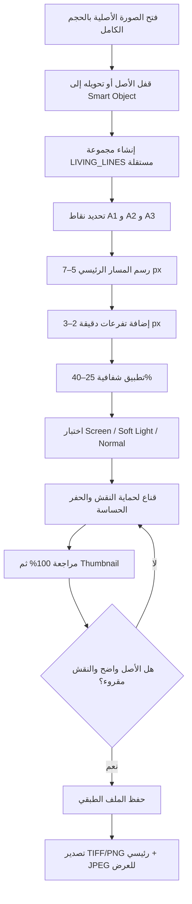

# تقرير تحليلي لتطبيق نظام «LIVING LINES» على صورة النقش الحجري

## الملخص التنفيذي

الصورة مناسبة جدًا لفكرة **الخطوط الحيّة** لأنها تجمع بين سطح أثري شديد الملمس، ونقش محفور واضح، وسماء زرقاء واسعة تعمل كمنطقة هادئة يمكن أن تمتد فيها الخطوط دون أن تنافس النص الحجري. القاعدة الأساسية في ملف **SYSTEM 6 — LIVING LINES** هي أن تبقى الصورة الأصلية كما هي، وأن تضاف فوقها طبقة رسم خطّي فقط، مرتبطة بعناصر حقيقية داخل الصورة وليست زخرفة مستقلة؛ كما يمنع النظام أي كتابة جديدة داخل الصورة، ويشترط أن يظل النقش الأصلي واضحًا وغير معدل. fileciteturn0file0

أفضل تنفيذ لهذه اللقطة هو **مسار خطّي واحد دافئ مائل للذهبي، منخفض الشفافية، يبدأ من نقاط ضوء موجودة أصلًا على حواف الحجر ثم يصعد إلى السماء، مع تفرعات قليلة جدًا تعكس الإيقاع الهندسي للنقش من دون تتبّع الحروف نفسها بشكل كثيف**. هذه المعالجة تتفق مع مبدأ «الانتماء للصورة» في النظام، وتحافظ على قدسية/أصالة العنصر الأثري، بينما تستفيد من المساحات الهادئة في السماء ومن الحواف الصخرية كمرتكزات بصرية. fileciteturn0file0

## قواعد SYSTEM 6 — LIVING LINES

الملف يفرض عقد إخراج واضحًا: الصورة الفوتوغرافية لا يعاد طلاؤها ولا تغيير قصّها أو إضاءتها أو ألوانها، وإنما تضاف طبقة خطية مرسومة يدويًا فوقها فقط. كما يشترط ألا تحتوي الصورة النهائية على أي عناوين أو أحرف أو أرقام أو توقيعات أو علامات مائية جديدة، مع إبقاء أي كتابة موجودة أصلًا في الصورة دون تغيير. fileciteturn0file0

التصميم يجب أن ينطلق من الصورة نفسها: الحواف، اتجاهات المنظور، مناطق الهدوء والازدحام، العمق، الضوء، والجزء «الناقص» أو غير المرئي الذي يمكن للخطوط أن تكشفه أو تكمله. ويؤكد النظام اختبارًا مهمًا: إذا أمكن نقل الرسم نفسه إلى صورة أخرى وظل صالحًا، فهو مجرد زخرفة وليس فكرة ناجحة. لذلك ينبغي لكل خط رئيسي أن يبدأ من عنصر حقيقي، أو يمر خلفه، أو يلتف حوله، أو يستجيب له بصريًا. fileciteturn0file0

بالنسبة لسماكة الخط، يعطي الملف إرشادًا عامًا بأن يكون الخط الرئيسي بنحو **0.4–0.8% من الضلع الأقصر للصورة**، مع سماكة ثانية أرفع فقط عند الحاجة. وبما أن الصورة هنا بعرض 1122 بكسل وارتفاع 1402 بكسل، فهذا يعادل تقريبًا **4.5–9 بكسلات** للخط الرئيسي، ويمكن اعتماد 2–4 بكسلات للتفاصيل الدقيقة. كما يوصي النظام بأن تشغل الخطوط تقريبًا من عُشر إلى ثلث الإطار، وأن يبقى ثلثا الصورة على الأقل واضحين بصريًا. fileciteturn0file0

الملف لا يفرض لونًا أو شفافية ثابتين؛ لذلك سأتبنى افتراضك المطلوب: **ذهبي دافئ أو ضوء كريمي، منخفض الشفافية، دون تعبئة مساحات كبيرة**. وهذا الافتراض يتوافق أيضًا مع إرشاد النظام باختيار لون يحقق تباينًا مناسبًا مع الخلفية، مع حصر اللون الثاني—إن استُخدم—في أقل من خمس الخطوط. fileciteturn0file0

## تحليل الصورة ومناطق الارتكاز

الصورة عمودية بنسبة تقارب 4:5، أبعادها **1122 × 1402 بكسل**، وتظهر فيها كتلة حجرية أثرية كبيرة في الثلثين السفليين تقريبًا، بينما تحتل السماء الزرقاء الداكنة الجزء العلوي. التحليل اللوني المبسط للصورة يعطي خمسة تجمعات رئيسية تقريبية: رملي ذهبي RGB≈(201,148,90)، أزرق داكن (20,55,96)، بني شديد العمق (74,48,28)، بني متوسط (144,100,58)، وأزرق متوسط (48,88,134). هذا يؤكد وجود ثنائية لونية قوية بين الحجر الدافئ والسماء الباردة، وهي مناسبة جدًا لخط ذهبي مضيء منخفض الشفافية.

الإضاءة جانبية ودافئة، تبدو قادمة من أسفل/يسار المشهد، مع نقاط ضوء قوية على الحافة اليسرى العليا للحجر وبعض الحواف اليمنى والسفلية. سطح الحجر خشن جدًا، مليء بالحفر الدقيقة والانقطاعات والنتوءات، بينما النقش نفسه يتكون من صفّين رئيسيين من الرموز المحفورة، موزعة أفقيًا عبر واجهة الصخرة. التفاصيل الأعلى كثافة تقع في وسط اللوح الحجري وعلى النقوش، أما مناطق الظل الثقيلة فتوجد في قاعدة الكتلة الصخرية، والركن السفلي الأيمن، وبعض التجاويف أسفل الحافة الأمامية.

من منظور نظام LIVING LINES، أفضل «نقطة بطل» hero point هي **وميض الضوء الموجود عند الزاوية اليسرى العليا للحجر**؛ فهي نقطة اتصال حقيقية بين الصورة والرسم ويمكن أن ينطلق منها المسار إلى السماء. نقطة ثانية ممتازة هي الوميض الموجود قرب الحافة اليمنى العليا للكتلة، ونقطة ثالثة عند التجويف المضيء في الجزء السفلي الأوسط. هذه النقاط تسمح بمسار واحد يبدو كما لو أن «ضوءًا أو ذاكرة» تسري عبر بنية الأثر بدل أن تُلصق فوقه زخرفة مستقلة. هذا يتوافق مع حركات Reveal وConnect وExtend الموصوفة في النظام. fileciteturn0file0

أنسب المسارات هي: امتداد خط من الحافة اليسرى إلى السماء مع اتباع منظور الحافة العليا؛ فرع ثانٍ يلتقط الزاوية الهندسية بين سطح الحجر والسماء ثم يواصلها كخط مكسّر خفيف؛ ومسار ثالث قصير قرب أسفل الحجر يلتف حول شق طبيعي ثم يتلاشى. ينبغي تجنب المرور فوق تجاويف الحروف نفسها إلا في حالات تماس قصيرة جدًا على حوافها الخارجية، لأن الأولوية هي ألا تنخفض مقروئية النقش أو أصالته.

### مخطط ارتكاز تقريبي

```text
                 السماء الهادئة
           A1 ●───────────────╲
              ╲                 ╲
               ╲      A2 ●──────╲
                ╲        ╲       ╲
─────────────────╲────────╲─────────  حافة الحجر
 [ نقش الصف الأول ]   [ نقش الصف الأول ]
 [ نقش الصف الثاني ]   [ نقش الصف الثاني ]

             A3 ●───────╲
                         ╲
                     شق/حافة صخرية
```

**A1** نقطة الوميض اليسرى وهي الأنسب كبداية. **A2** نقطة الضوء اليمنى وتصلح كمرساة ثانوية. **A3** نقطة ضوء منخفضة قرب الشق الصخري ويمكن استخدامها كتكرار بصري محدود، لا كمسار مستقل كبير.

## خطة التنفيذ التحريرية

النهج الأفضل هو تحرير غير هدّام: يُحتفظ بالصورة الأصلية كطبقة أساس مقفلة أو Smart Object، وتوضع كل الخطوط في طبقة مستقلة أو مجموعة طبقات فوقها. توصي Adobe بالتحرير غير الهدّام عبر Smart Objects وطبقات الضبط والأقنعة بحيث تظل بيانات الصورة الأصلية محفوظة ويمكن تعديل التأثيرات أو إلغاؤها لاحقًا. citeturn778483search0turn778483search3

ابدأ بنسخة عمل من الأصل من دون إعادة تحجيم، ثم أنشئ مجموعة باسم `LIVING_LINES`. ارسم مسارًا رئيسيًا بفرشاة دائرية صلبة أو Ink brush ذات حافة نظيفة مع قدر بسيط من تفاوت الضغط، بقطر أساسي **5–7 px**، واستخدم **2–3 px** فقط للتفرعات الدقيقة. لتجنب الطابع المتجهي المثالي، يجب السماح بانحرافات صغيرة في المسار وزوايا غير متطابقة تمامًا، لأن النظام يطلب «يدًا واحدة واثقة» لا خطوطًا آلية مثالية. fileciteturn0file0

اللون المقترح هو ذهبي دافئ قريب من `#F2C878` أو كريمي ذهبي قريب من `#FFE0A0`. ابدأ بشفافية طبقة بين **25–40%**، واختبر نمط المزج **Screen** أو **Linear Dodge (Add)** على السماء، ثم **Soft Light** أو **Normal** فوق مناطق الحجر حسب الحاجة. في Photoshop يمكن التحكم في الشفافية ونمط المزج لكل طبقة بصورة مستقلة لرؤية تأثير مباشر على الطبقات الواقعة أسفلها. citeturn778483search1

استخدم Layer Mask على مجموعة الخطوط لحجبها بدقة فوق الأجزاء التي تقل فيها مقروئية النقش، خصوصًا داخل التجاويف العميقة للحروف وعلى المناطق الداكنة جدًا. الأقنعة تسمح بإخفاء أجزاء من الطبقة دون حذفها نهائيًا، وهو أسلوب غير هدّام وقابل للتعديل لاحقًا. citeturn778483search5turn778483search6

لا تضف Glow كبيرًا. إن احتجت وهجًا، أنشئ نسخة مكررة من الخطوط، Blur خفيف جدًا بين 2–4 px، وشفافية 10–18% فقط، كي يبدو الضوء جزءًا من المشهد لا مؤثرًا رقميًا منفصلًا. يفضّل أن يكون الوهج أقوى قليلًا في السماء وأضعف فوق الحجر حتى لا يغسل الملمس.

قبل التصدير، افحص الصورة عند 100% ثم عند حجم مصغّر. يجب أن يظل المشاهد يرى أولًا «نقشًا أثريًا حقيقيًا»، ثم يكتشف الخطوط كضربة ثانية. احفظ ملف العمل بطبقاته، وصدّر نسخة رئيسية TIFF أو PNG بالحجم الأصلي إذا كان الهدف أرشيفيًا أو إنتاجيًا، وJPEG عالي الجودة للعرض. مكتبة الكونغرس توصي بالاحتفاظ بأعلى دقة متاحة وعدم إعادة التحجيم أو الاستيفاء دون حاجة، وتعتبر TIFF من الصيغ الملائمة للنسخ الرئيسية عالية الجودة، بينما JPEG مناسب لنسخ الوصول والاستخدام العملي. citeturn778483search14turn778483search30

## مقارنة الأساليب البصرية

| الأسلوب | الوصف | المزايا | العيوب | الشفافية المقترحة | نمط المزج |
|---|---|---|---|---:|---|
| خط ذهبي رفيع واحد | مسار واحد متصل يخرج من A1 ويتبع الحواف والمنظور | الأكثر احترامًا للنقش، واضح، أنيق، يحقق فكرة «الذاكرة/الضوء» | قد يبدو هادئًا جدًا إذا قلّ التفرع | 30–40% | Screen أو Normal |
| خيوط متعددة باهتة | 2–3 مسارات شبه متوازية بتفاوت طفيف | يعطي إحساسًا بالحركة والزمن والطاقة | أكثر عرضة للزحام فوق التفاصيل | 15–28% لكل خيط | Screen / Soft Light |
| عقد هندسية متصلة | نقاط صغيرة تربطها خطوط زاويّة مستوحاة من حواف النقش | ينسجم مع هندسية الرموز ويبدو معاصرًا | قد يتحول بسهولة إلى مخطط تقني أو يسرق الانتباه | 20–32% | Linear Dodge أو Screen |

الاختيار الموصى به هو **الخط الذهبي الواحد مع تفرع واحد أو اثنين فقط**؛ فهو الأقرب إلى شرط «ارسم أقل مما تريد» ويحافظ على مركزية الأثر نفسه. fileciteturn0file0



## برومبت إنجليزي جاهز للتنفيذ الخارجي

يمكن استخدام النص التالي مع نموذج تحرير صور يدعم image-to-image أو مع Photoshop/Generative Fill مع مرجع الصورة الأصلي. هذا البرومبت مبني مباشرة على بنية الـBrief المطلوبة في SYSTEM 6. fileciteturn0file0

> Keep the attached photograph exactly as it is: the same ancient stone inscription, crop, perspective, colors, lighting, sharpness, carved glyphs, stone texture, shadows, highlights, and every original photographic detail. Do not repaint, relight, filter, retouch, reconstruct, or restyle the photograph. Add only one separate hand-drawn continuous line-art layer on top.
>
> Draw a subtle luminous warm-gold continuous path that begins at the existing bright highlight on the upper-left edge of the stone, follows and extends the real perspective edges of the slab, then rises into the calm blue sky as a few restrained angular branches. Let one secondary branch visually connect toward the existing highlight near the upper-right stone edge, and allow one short low branch to respond to a natural crack near the lower illuminated rock edge. The lines must visibly originate from and react to real edges in this exact photograph.
>
> Use a fine hand-drawn light-pen feel, approximately 5–7 px main stroke width at 1122×1402 output, with occasional 2–3 px secondary strokes. Use warm pale gold, low opacity, subtle glow only, no fills, no decorative symbols, and no vector-perfect geometry. Preserve the full legibility of every carved glyph; mask the line wherever it would obscure the inscription.
>
> Keep the carved inscription, stone surface, foreground shadows, and all archaeological details completely clear. Maintain the original camera angle and existing golden side-light exactly. Output at the original resolution, 1122×1402 px, with no crop or rescaling.
>
> The drawing contains no words, letters or numbers, and the photograph underneath is unchanged.
>
> **Negative prompt:** new text, captions, Arabic text, Latin text, numbers, logos, signatures, watermark, labels, symbols resembling writing, altered inscription, invented glyphs, rewritten carvings, erased carvings, blurred stone texture, smoothed stone, changed lighting, changed camera angle, crop, reframing, fantasy architecture, added people, added objects, neon tubes, excessive glow, thick outlines, cartoon style, vector-perfect lines, stickers, decorative stars, hearts, arrows, generic swirls.

## العبارات العربية بعد الصورة

الفكرة: ضوءٌ يصل الحاضر بأثرٍ ما زال يتكلم.

هل كان الحجر يحفظ مسار الضوء طوال هذا الزمن؟

خطٌ واحد يمرّ بالأثر، فيوقظ ذاكرته دون أن يغيّره.